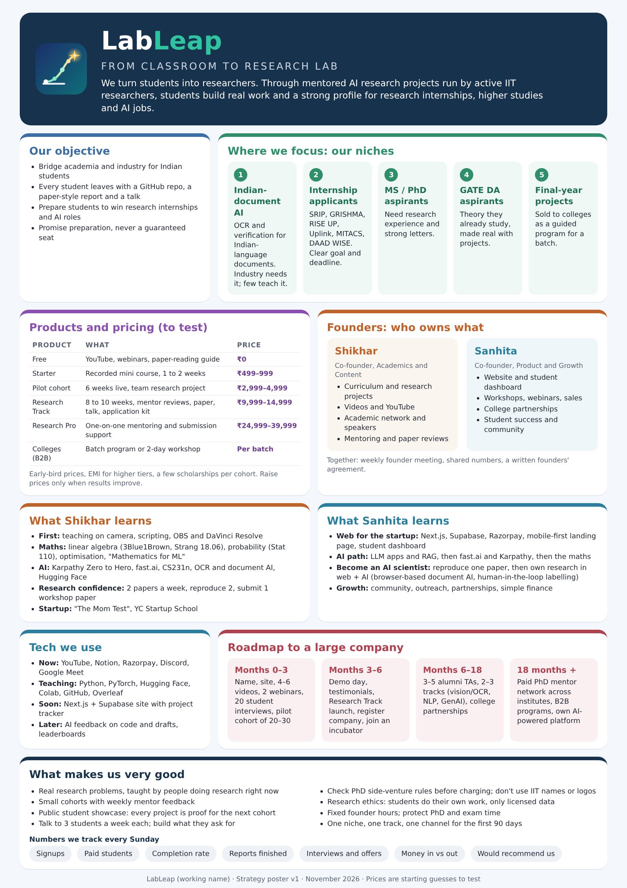

# Leapverse: leap into AI, research and beyond

Founders: Shikhar Dubey and Sanhita Saxena

We help students make their next big leap in AI, research and careers. We start with mentored AI research projects run by active IIT researchers, students build real work and a strong profile for research internships, higher studies and AI jobs.

**Leapverse** is a universe of leaps: research first, then AI skills, careers and whatever else we add. The symbol shows a leap: a network path rising from the ground (where a student starts) to a star (their breakthrough). Leapverse is a working name. Check the domain, trademark and social handles before using it publicly.

## What's in this repository

| Path | What it is |
|---|---|
| [docs/01-startup-plan.md](docs/01-startup-plan.md) | Full plan: competitors, offer, tech, content, first 90 days, scaling, risks |
| [docs/02-learning-roadmap-shikhar.md](docs/02-learning-roadmap-shikhar.md) | What Shikhar learns: teaching on camera, AI, maths, research confidence, startup skills |
| [docs/03-founder-roles.md](docs/03-founder-roles.md) | Who owns what, how to be better founders, weekly rhythm |
| [docs/04-niche-markets-and-pricing.md](docs/04-niche-markets-and-pricing.md) | Five niches to target and the pricing ladder |
| [docs/05-learning-roadmap-sanhita.md](docs/05-learning-roadmap-sanhita.md) | What Sanhita learns: web for the startup and the path to AI scientist |
| [docs/06-website-and-app-launch.md](docs/06-website-and-app-launch.md) | How to put the website online and publish the Android app on the Play Store |
| [website/](website/) | The Leapverse website, installable as an app (open `website/index.html` to preview) |
| [android/](android/) | Android app settings (`twa-manifest.json`) and Play Store images |
| [assets/mind-map-v2.png](assets/mind-map-v2.png) | Mind map v2: objective, niches, pricing, founders, growth (also `.svg`) |
| [assets/mind-map-v1.png](assets/mind-map-v1.png) | Mind map v1 from the first plan |
| [brand/](brand/) | Logo (made by `source/make-logo.py`): `logo-full.svg/png` (icon and name), `logo-icon.svg/png` (icon only) |
| [exports/strategy-poster-v1.pdf](exports/strategy-poster-v1.pdf) | Big strategy poster, A2 size, ready to print (also `.png`) |
| [exports/startup-plan-v1.pdf](exports/startup-plan-v1.pdf) | PDF of the first plan with mind map |
| [source/](source/) | Files that generate the exports: poster HTML, plan HTML, mind map script |

## Naming conventions

- Folders: `docs/` for writing, `assets/` for diagrams and images, `brand/` for the logo, `exports/` for PDFs and shareable images, `source/` for files that generate exports.
- Files are lowercase with hyphens, for example `learning-roadmap-sanhita.md`.
- Docs are numbered in reading order: `01-` to `06-`. Add new ones as `07-...`, `08-...`.
- Versioned files end in `-v1`, `-v2` and so on. Keep old versions; add a new one when something changes.

To update the mind map, edit the list in `source/make-mind-map-v2.py` and run `python3 source/make-mind-map-v2.py`.

Suggested next files: `docs/07-pilot-course-outline.md`, `docs/08-student-interview-notes.md`, `docs/09-founders-agreement-notes.md`.
