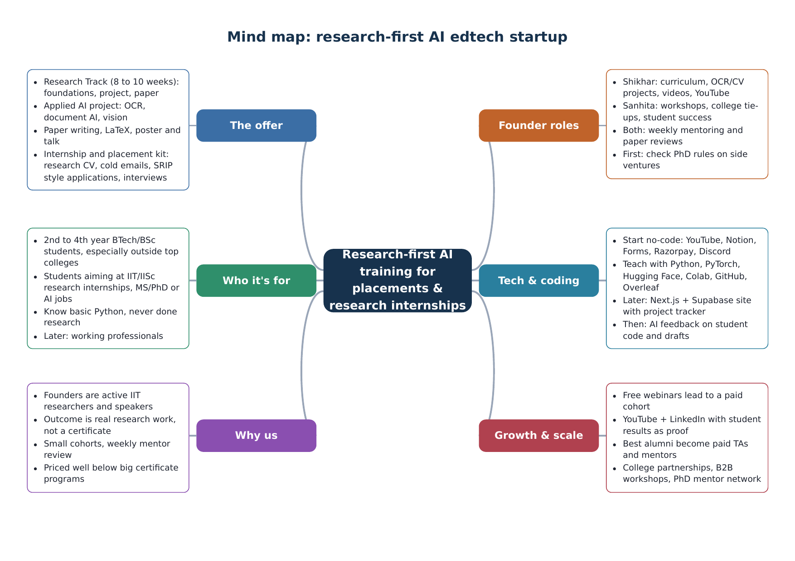
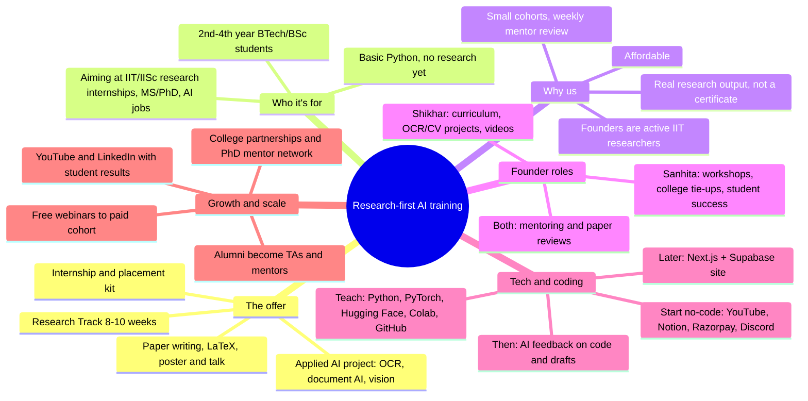

# Startup plan: research-first AI edtech

Founders: Shikhar Dubey and Sanhita Saxena · Plan drafted 10 November 2026

> We take students who have never done research, put them through a mentored AI research project run by active IIT researchers, and help them turn that work into a paper, a portfolio and strong applications for research internships and AI jobs.

Prices and numbers below are starting guesses to test, not facts.

## Mind map

## 1. Competitors and where we fit

| Who | What they sell | Gap we fill |
|---|---|---|
| Scaler, upGrad, Coding Ninjas, AlmaBetter | Placement bootcamps built around DSA, development and data science | Little or no real research |
| IIT-branded certificate programs via partners (Masai with IIT Roorkee EICT, Intellipaat with iHUB IIT Roorkee) | IIT name on a certificate plus a broad AI/ML curriculum | Outcome is a certificate, mentoring is thin |
| NPTEL / SWAYAM | Free or cheap IIT lectures | No project, no mentor, no application help |
| Research mentorship (Polygence, Lumiere and similar) | One-on-one research ending in a paper | Mostly high-schoolers abroad, priced in dollars |
| Official internships (SRIP IIT Gandhinagar, IIT Mandi summer internship, GRISHMA IIT Kharagpur, RISE UP IIT Jammu, ACM iKDD Uplink) | Not competitors: the destination | Students apply with no research to show |

**Position:** affordable, India-focused, mentored research by people doing research now, ending in a real artifact and a strong application.

**What makes it different**
- Outcome over certificate: public GitHub repo, 4 to 6 page report, recorded talk.
- Real research problems from our area: OCR, document verification, Indian-language documents.
- Teaching how research actually works: reading papers, baselines, ablations, writing, presenting.
- Application coaching: research CV, emails to professors, interviews.
- Honest promise: we prepare students to compete; we never guarantee seats.

## 2. Offer and pricing (to test)

| Product | What's inside | Starting price |
|---|---|---|
| Free webinars / YouTube | Research internships explained, reading AI papers, OCR in 60 minutes | Free |
| Pilot cohort (6 weeks) | 20 to 30 students, teams of 2 to 3, weekly class and review | ₹1,999 to ₹3,999 |
| Full Research Track (8 to 10 weeks) | Foundations, project, paper and talk, application kit | ₹7,999 to ₹14,999 |
| Add-ons | Paper review, mock interview, CV review | ₹499 to ₹1,499 |
| College workshops (B2B) | 2-day intro to AI research | Per workshop |

**Research Track outline**
- Weeks 1 to 2: Python/PyTorch refresher, reading papers, Hugging Face, Git, Colab.
- Weeks 3 to 7: project (e.g. OCR on Hindi forms, tampered-document detection, table extraction), baseline, improvements, ablations.
- Weeks 8 to 9: Overleaf paper and 5-minute talk.
- Week 10: research CV, GitHub cleanup, professor emails, applications, mock interviews.

## 3. Who learns what first

| | Shikhar | Sanhita |
|---|---|---|
| Main role | Curriculum, OCR/CV projects, videos, tech setup | Workshops, college partnerships, community, student success |
| Learn first | Video workflow (OBS, DaVinci Resolve), outcome-first course design, Notion/Razorpay/Discord setup | Community management, outreach to college clubs, sales script, lead tracking |
| Learn next | Next.js + Supabase, YouTube SEO | Partnership agreements, GST and invoicing, hiring TAs |
| Shared | Mentoring, paper reviews, company registration basics, weekly numbers review | |

## 4. Coding and tech strategy

**Rule:** don't build a platform until about 100 paying students.

- **Phase 0 (months 0 to 6), no code:** YouTube, Meet/Zoom, Notion, Google Forms, Razorpay links, Discord, GitHub template repos.
- **Teaching code from day one:** starter repos and Colab notebooks; Python, PyTorch, Hugging Face, OpenCV; OCR with Tesseract, PaddleOCR, TrOCR, Donut, LayoutLM-style models; shared evaluation scripts and leaderboards; Overleaf templates.
- **Phase 1 (6 to 18 months):** Next.js on Vercel, Supabase, Razorpay; project tracker; student showcase pages.
- **Phase 2:** AI first-pass feedback on code and drafts; benchmark leaderboards; mentor matching.

## 5. Video and YouTube content

- Free: how to get into research, reading AI papers, research internships in India explained, OCR from scratch, emailing professors.
- Paid: project builds, writing a paper section by section, ablations, presenting.
- Proof: demo-day clips and student stories (with permission).
- Rhythm: one long video and two Shorts a week.

## 6. First 90 days

| When | What | Done when |
|---|---|---|
| Weeks 1 to 2 | Check PhD side-venture rules, pick a name, define the Document AI track, set up tools | Rules checked, signup page live |
| Weeks 3 to 4 | 4 to 6 videos, 2 free webinars, reach 20 college clubs | 200+ signups |
| Weeks 5 to 10 | Pilot cohort of 20 to 30 students | 70%+ teams submit a report |
| Weeks 11 to 12 | Demo day, publish best reports, testimonials, internship applications, set cohort 2 price | Applications sent, price set |

Track: signups, paid conversion, completion, reports finished, applications, interviews and offers, student recommendation score.

## 7. Scaling from two people

| Stage | Team | What changes |
|---|---|---|
| 0 to 6 months | The two founders | 1 to 2 cohorts, one track, no-code tools |
| 6 to 18 months | + 3 to 5 alumni TAs, part-time editor | 2 to 3 tracks, own website, college partnerships, register company, apply to incubators |
| 18 months+ | + paid PhD mentor network | Mentors paid per student, B2B programs, AI feedback tools |

## 8. Risks and rules to check

- PhD rules on outside work and startups: check with advisor and incubator before charging money.
- Don't use IIT names or logos in branding; state facts only.
- No placement guarantees.
- Research ethics: students do their own work; only public or licensed datasets, especially for identity documents.
- Founder time: cap cohort size until TAs exist.

## 9. Balancing note

Fixed slots: exam prep in the morning, startup in the evening, one weekend recording block. Every course video doubles as YouTube content. Review the week every Sunday.

## Sources

- [SRIP, IIT Gandhinagar](https://education.vikaspedia.in/viewcontent/education/internship-opportunities-for-students/summer-research-internship-program-(srip)-at-iit-gandhinagar?lgn=en)
- [IIT Mandi summer internship 2026](https://news.careers360.com/iit-mandi-opens-summer-internship-2026-application-for-ug-pg-students-monthly-stipend-of-rs-10-thousand-eligibility/amp)
- [GRISHMA UG internship, IIT Kharagpur](https://kriti.iitkgp.ac.in/programs/grishma)
- [RISE UP 2026, IIT Jammu](https://eduadvice.in/educational-news-details/internship-riseup-2026-at-iit-jammu/10312)
- [ACM iKDD Uplink 2026](https://ikdd.acm.org/uplink-2026.php)
- [Masai and IIT Roorkee EICT AI/ML program](https://www.masaischool.com/iit-roorkee-eict/ai-ml)
- [Intellipaat and iHUB IIT Roorkee program](https://intellipaat.com/ai-data-science-from-ihub-iit-roorkee-prime/)
- [IIT certificate courses in AI compared (2026)](https://www.masaischool.com/blog/iit-certificate-courses-in-ai-every-program-compared-2026/)
